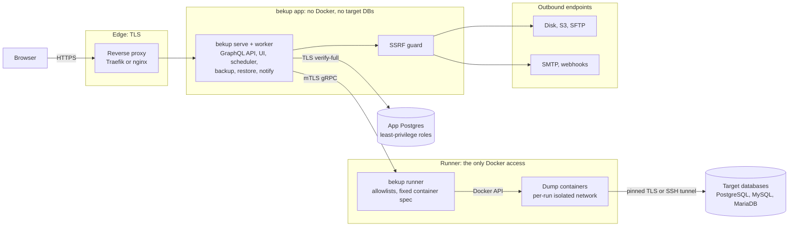

<p align="center">
  <picture>
    <source media="(prefers-color-scheme: dark)" srcset="docs/assets/bekup-banner-dark.svg">
    <source media="(prefers-color-scheme: light)" srcset="docs/assets/bekup-banner-light.svg">
    
  </picture>
</p>

<p align="center">
  <a href="https://github.com/jlentink/bekup/actions/workflows/ci.yml"></a>
  <a href="LICENSE"></a>
  <a href="go.mod"></a>
  <a href="Dockerfile"></a>
  
</p>

<p align="center">
  <b>Self-hosted, security-first backups for PostgreSQL, MySQL and MariaDB.</b><br>
  <a href="docs/README.md">Docs</a> ·
  <a href="docs/getting-started.md">Getting started</a> ·
  <a href="SECURITY.md">Security</a> ·
  <a href="docs/DECISIONS.md">Decisions</a>
</p>

> [!WARNING]
> **bekup is under development and not ready for production use.**
> Interfaces, configuration and file formats may change without notice.

## Why bekup

Database backups hold your most sensitive data, yet backup tools often get
broad network access, a Docker socket and plaintext credentials. bekup runs
each database's **native dump tools in the official, digest-pinned Docker
images**, so every server version gets a matching client. It encrypts and
signs every backup, writes it to **disk, S3 and SFTP**, applies retention
and restores on demand. You manage it in a React web UI backed by a Go
GraphQL API. When convenience and security conflict, security wins.

## Security first

| Control | What it means |
|---|---|
| **Encrypted, signed backups** | age encryption is on by default, and each run has a signed manifest. Restores are staged and verified before anything is written. |
| **Isolated runner** | Only the `bekup runner` sidecar talks to Docker. Dump containers run on isolated per-run networks and reach exactly one allowlisted target. The web backend never reaches Docker or your databases. |
| **Pinning and mTLS** | Database connections use TLS with certificate pinning by default (`PINNED`); a downgrade needs an admin with step-up, is audited and alerted and shows a permanent *Insecure transport* badge. SSH/SFTP host keys are pinned. `serve` and the runner talk over mutual TLS with a private CA. |
| **Write-only credentials** | Credentials are envelope-encrypted, write-only in the API and never logged. Secrets are read from files only, never inline or from env. |
| **Strong sign-in** | Passkeys, TOTP and step-up for sensitive actions. Every restore needs a fresh second factor. |
| **Tamper-evident audit** | The audit log is append-only and hash-chained, and you can verify it with `bekup audit verify`. |
| **SSRF guard** | All outbound traffic to S3, SFTP, SMTP and webhooks is checked at dial time: private and internal addresses are blocked unless an admin allowlists them per scope (public addresses are allowed). |
| **No silent weakening** | Security-relevant changes in the UI need an admin with step-up and are audited; posture downgrades (encryption opt-out, unpinned or unencrypted database TLS) also alert and show a permanent badge. A config reload that weakens a live limit (from the UI or with SIGHUP on the host) is audited and alerts every admin, without a badge (D-200). |

Read the threat model in [SECURITY.md](SECURITY.md).

## Features

**Databases**
- PostgreSQL, MySQL and MariaDB, each with the official image for its server version.
- Back up all databases (one file per database, plus PostgreSQL globals) or a selection.
- Completeness evidence: object and row counts are captured with each dump.

**Destinations**
- Reusable disk, S3 (incl. Object Lock) and SFTP destinations, with fan-out to several per job.
- Dial-time SSRF guard and pinned SFTP host keys.

**Scheduling and retention**
- Interval or cron schedules with time zones and DST handling; **Run now** or **start the next run early**.
- A **calendar** of planned runs, past runs, skips and expiries.
- Retention by count and/or age per destination; it never deletes the newest complete backup.
- Missed-backup detection and alerts.

**Restore**
- Restore into a new database or overwrite one: a temporary database and swap for PostgreSQL, in place for MySQL/MariaDB.
- Temporary restore connections (admin only) and privileged-target checks.
- **Scheduled test restores** into a scratch database, compared with the backup's statistics.
- Raw or decrypted **downloads** through short-lived, single-use tickets.

**Access**
- Roles: Admin, Maintainer and User (backup owner), enforced by a deny-by-default authorization matrix.
- Passkeys, TOTP, recovery codes, an admin-set 2FA policy and step-up confirmation.

**Notifications and monitoring**
- In-app inbox, e-mail and HMAC-signed webhooks, with shared channels and personal ones.
- Per-user notification preferences under **Profile → Notifications**.
- Security alerts for admins and affected users.
- Prometheus metrics on a separate internal listener.

**Operations**
- Live config reload: **Admin → Settings → Configuration**, or `SIGHUP` for a single process.
- Offline recovery without the bekup database: `bekup verify`, `bekup decrypt` and `bekup reindex`.
- Multi-arch images for your own registry (`just publish`).

## Architecture



Components, networks and data flows are described in
[docs/architecture.md](docs/architecture.md).

## Quick start

<details>
<summary><b>Try it locally (development)</b></summary>

You need Docker, Go, [just](https://just.systems/), openssl, and Node.js
with pnpm for the UI.

```sh
just doctor                                    # check the required tools and the Docker daemon
just dev                                       # dev keys (once), app Postgres with TLS, mailpit, adminer, migrations
just admin-create you@example.com "Your Name"  # the first admin; the password is prompted
just run                                       # bekup serve on http://localhost:8080 (plain HTTP, dev only)
just web-dev                                   # optional: Vite with hot reload on http://localhost:5173
just dev-runner                                # optional: the runner and sample target databases
```

Sign in, enroll a second factor under **Profile → Two-factor**, then add a
connection, a destination and a job. Plain HTTP shows a permanent warning
banner, which is expected in dev. Details:
[docs/getting-started.md](docs/getting-started.md#development-quick-start).

</details>

<details>
<summary><b>Production (Docker Compose)</b></summary>

The full procedure is in
[docs/installation/compose.md](docs/installation/compose.md#first-start-target-flow).
In short:

1. Create `bekup.toml` and `runner.toml` from the `*.example.toml` files
   ([configuration](docs/configuration.md)).
2. Create the secret files in `secrets/` and the master key
   (`just keygen` or `bekup keys generate`). Escrow the key offline.
3. Create the mTLS certificates once with
   `docker compose --profile setup run --rm certs-init`, then move
   `secrets/certs/ca/` offline.
4. Start the stack with exactly one reverse-proxy profile:
   `docker compose --profile traefik up -d` (or `--profile nginx`).
5. Create the first admin on the host:
   `docker compose run --rm admin create --email you@example.com --display-name "Your Name"`.

</details>

## Documentation

| Topic | Pages |
|---|---|
| Start | [Getting started](docs/getting-started.md) · [Architecture](docs/architecture.md) · [Documentation index](docs/README.md) |
| Install | [Docker Compose](docs/installation/compose.md) · [Reverse proxy and TLS](docs/installation/reverse-proxy.md) · [Upgrades](docs/installation/upgrades.md) |
| Configure | [Configuration reference](docs/configuration.md) |
| Use | [Connections](docs/guides/connections.md) · [Destinations](docs/guides/destinations.md) · [Jobs and schedules](docs/guides/jobs-and-schedules.md) · [Retention](docs/guides/retention.md) · [Encryption](docs/guides/encryption.md) · [Downloads](docs/guides/downloads.md) · [Restore](docs/guides/restore.md) · [Notifications](docs/guides/notifications.md) |
| Operate | [Operations and metrics](docs/operations.md) · [Disaster recovery](docs/recovery.md) |
| Secure | [Threat model](SECURITY.md) · [Hardening](docs/security/hardening.md) · [Key management](docs/security/key-management.md) · [Audit log](docs/security/audit.md) |
| Reference | [CLI and GraphQL reference](docs/reference/README.md) · [Decision log](docs/DECISIONS.md) |

## Development and contributing

`just` with no arguments prints every recipe, grouped. The everyday checks:

```sh
just lint       # golangci-lint (incl. gosec), buf, eslint + tsc
just test       # unit tests (Go with the race detector, scripts, vitest)
just test-int   # integration tests with testcontainers (needs Docker)
just sec        # govulncheck and osv-scanner
```

Read [AGENTS.md](AGENTS.md) for the conventions and
[docs/development.md](docs/development.md) for the local setup. Every change
needs tests, and every design decision needs an entry in the
[decision log](docs/DECISIONS.md).

## Security

Please don't open a public issue for a vulnerability. Report it privately as
described in
[SECURITY.md](SECURITY.md#1-reporting-a-vulnerability).

## License

[MIT](LICENSE) © 2026 Jason Lentink
