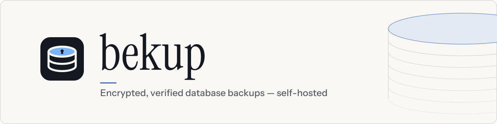
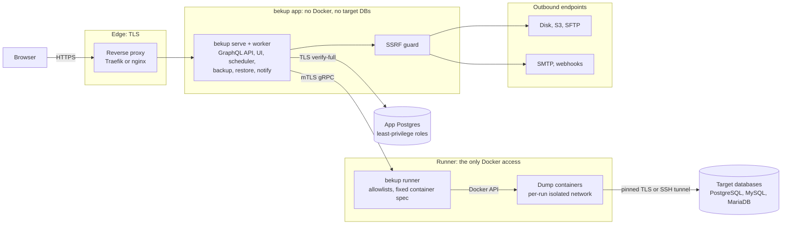

<p align="center">
  <picture>
    <source media="(prefers-color-scheme: dark)" srcset="docs/assets/bekup-banner-dark.svg">
    <source media="(prefers-color-scheme: light)" srcset="docs/assets/bekup-banner-light.svg">
    
  </picture>
</p>

<p align="center">
  <a href="https://github.com/jlentink/bekup/actions/workflows/ci.yml"></a>
  <a href="LICENSE"></a>
  <a href="go.mod"></a>
  <a href="Dockerfile"></a>
  
</p>

<p align="center">
  <b>Self-hosted, security-first backups for PostgreSQL, MySQL and MariaDB.</b><br>
  <a href="docs/README.md">Docs</a> ·
  <a href="docs/getting-started.md">Getting started</a> ·
  <a href="SECURITY.md">Security</a> ·
  <a href="docs/DECISIONS.md">Decisions</a>
</p>

## Why bekup

Database backups hold your most sensitive data, yet backup tools often get
broad network access, a Docker socket and plaintext credentials. bekup runs
each database's **native dump tools in the official, digest-pinned Docker
images**, so every server version gets a matching client. It encrypts and
signs every backup, writes it to **disk, S3 and SFTP**, applies retention
and restores on demand. You manage it in a React web UI backed by a Go
GraphQL API. When convenience and security conflict, security wins.

## Security first

| Control | What it means |
|---|---|
| **Encrypted, signed backups** | age encryption is on by default, and each run has a signed manifest. Restores are staged and verified before anything is written. |
| **Isolated runner** | Only the `bekup runner` sidecar talks to Docker. Dump containers run on isolated per-run networks and reach exactly one allowlisted target. The web backend never reaches Docker or your databases. |
| **Pinning and mTLS** | Database connections use TLS with certificate pinning by default (`PINNED`); a downgrade needs an admin with step-up, is audited and alerted and shows a permanent *Insecure transport* badge. SSH/SFTP host keys are pinned. `serve` and the runner talk over mutual TLS with a private CA. |
| **Write-only credentials** | Credentials are envelope-encrypted, write-only in the API and never logged. Secrets are read from files only, never inline or from env. |
| **Strong sign-in** | Passkeys, TOTP and step-up for sensitive actions. Every restore needs a fresh second factor. |
| **Tamper-evident audit** | The audit log is append-only and hash-chained, and you can verify it with `bekup audit verify`. |
| **SSRF guard** | All outbound traffic to S3, SFTP, SMTP and webhooks is checked at dial time: private and internal addresses are blocked unless an admin allowlists them per scope (public addresses are allowed). |
| **No silent weakening** | Security-relevant changes in the UI need an admin with step-up and are audited; posture downgrades (encryption opt-out, unpinned or unencrypted database TLS) also alert and show a permanent badge. A config reload that weakens a live limit (from the UI or with SIGHUP on the host) is audited and alerts every admin, without a badge (D-200). |

Read the threat model in [SECURITY.md](SECURITY.md).

## Features

**Databases**
- PostgreSQL, MySQL and MariaDB, each with the official image for its server version.
- Back up all databases (one file per database, plus PostgreSQL globals) or a selection.
- Completeness evidence: object and row counts are captured with each dump.

**Destinations**
- Reusable disk, S3 (incl. Object Lock) and SFTP destinations, with fan-out to several per job.
- Dial-time SSRF guard and pinned SFTP host keys.

**Scheduling and retention**
- Interval or cron schedules with time zones and DST handling; **Run now** or **start the next run early**.
- A **calendar** of planned runs, past runs, skips and expiries.
- Retention by count and/or age per destination; it never deletes the newest complete backup.
- Missed-backup detection and alerts.

**Restore**
- Restore into a new database or overwrite one: a temporary database and swap for PostgreSQL, in place for MySQL/MariaDB.
- Temporary restore connections (admin only) and privileged-target checks.
- **Scheduled test restores** into a scratch database, compared with the backup's statistics.
- Raw or decrypted **downloads** through short-lived, single-use tickets.

**Access**
- Roles: Admin, Maintainer and User (backup owner), enforced by a deny-by-default authorization matrix.
- Passkeys, TOTP, recovery codes, an admin-set 2FA policy and step-up confirmation.

**Notifications and monitoring**
- In-app inbox, e-mail and HMAC-signed webhooks, with shared channels and personal ones.
- Per-user notification preferences under **Profile → Notifications**.
- Security alerts for admins and affected users.
- Prometheus metrics on a separate internal listener.

**Operations**
- Live config reload: **Admin → Settings → Configuration**, or `SIGHUP` for a single process.
- Offline recovery without the bekup database: `bekup verify`, `bekup decrypt` and `bekup reindex`.
- Multi-arch images for your own registry (`just publish`).

## Architecture



Components, networks and data flows are described in
[docs/architecture.md](docs/architecture.md).

## Quick start

You need a Linux host with Docker Engine 26+ and Compose 2.24+, and a DNS
name for the UI. Every step runs as root (or a member of the `docker`
group) in the deployment directory.

**One command: the setup wizard.** In an empty directory, run the setup
wizard of the bekup image, then start the stack:

```sh
IMAGE=ghcr.io/jlentink/bekup:latest
sudo docker pull "$IMAGE"
sudo install -d -m 0755 /opt/bekup && cd /opt/bekup
sudo docker run --rm -it --log-driver none --network none --read-only --tmpfs /tmp \
  --user 0:0 --cap-drop ALL --cap-add CHOWN --security-opt no-new-privileges \
  -e BEKUP_IMAGE="$IMAGE" -e DOCKER_GID="$(stat -c %g /var/run/docker.sock)" \
  -v "$PWD":/deploy "$IMAGE" setup
sudo docker compose up -d
sudo docker compose run --rm admin create --email you@example.com --display-name "Your Name"
```

The image exists once the first release is published (the release workflow
moves `:latest` to the newest release); before that, build and publish your
own with `just publish` and use its reference.

The wizard asks for the reverse proxy (bekup's own Traefik, your Traefik,
Nginx Proxy Manager or none), the domain, the database (bundled, or your
existing PostgreSQL 15-17), the master key and the internal CA, shows a
summary and writes everything, `compose.yaml` included. Esc goes back;
nothing is written before the summary. The container has no network and
only `CAP_CHOWN`; `--log-driver none` keeps a generated passphrase out of
Docker's logs. With your own PostgreSQL, run the one command it prints
before `up -d`, usually
`sudo docker compose run --rm migrate db bootstrap --admin-user <admin>`
([docs/installation/external-database.md](docs/installation/external-database.md)).
Details: [docs/installation/compose.md](docs/installation/compose.md#install-with-the-setup-wizard).

**Following `:latest` or pinning a digest.** With `:latest` the wizard
explains the choice and defaults to *following* the tag: `compose.yaml`
names `ghcr.io/jlentink/bekup:latest`, so `docker compose pull` fetches new
releases. This is an explicit weakening (D-212): whoever moves the tag
decides what runs. bekup keeps upgrades a deliberate step: migrate, serve,
worker and the runner refuse to start on a version setup has not prepared,
so upgrade with `sudo docker compose pull`, `sudo docker compose run --rm
setup upgrade`, `sudo docker compose up -d`. serve warns at every start,
audits it and alerts every admin daily. For strict change control choose
*pin a digest* in the wizard (or set
`IMAGE=ghcr.io/jlentink/bekup:<version>@sha256:<digest>`). To pin later,
run `setup upgrade --write-compose --image <pinned>` from **that pinned
image** (or one of the same version, so the recorded version matches what
runs), with the same `docker run` options as above; the recipe is in
[docs/installation/upgrades.md](docs/installation/upgrades.md#following-latest).

### Advanced: start from a compose file

Pick the variant that matches your reverse proxy. Each also exists as
`*.external-db.yaml` for your own PostgreSQL: save that file as
`compose.yaml`, put your PostgreSQL's CA bundle (PEM) into the directory
before step 2 (setup asks for its path and copies it), and run the
bootstrap command setup prints
(`docker compose run --rm migrate db bootstrap --admin-user <admin>`)
before `docker compose up -d`
([docs/installation/external-database.md](docs/installation/external-database.md)).
Each variant is one compose file, committed in
[`deploy/compose/`](deploy/compose/) (generated, never edited by hand; the
image comes from `BEKUP_IMAGE`) and, once releases exist, also published
with every release with the bekup image pinned by digest and attested.

**The image.** With the committed file, step 2 names the bekup image pinned
by digest, `BEKUP_IMAGE=<registry>/bekup:<version>@sha256:<digest>`, or
`BEKUP_IMAGE=ghcr.io/jlentink/bekup:latest` to follow the releases (an
explicit weakening, D-212; no other unpinned reference is accepted); setup
keeps it in `.env` for every later command.
The digest comes from the output of `just publish` (your own registry), the
release notes, or `docker image inspect --format '{{index .RepoDigests 0}}'
<registry>/bekup:<version>` after a `docker pull` (it prints
`<registry>/bekup@sha256:…`; keep `:<version>` in front of the `@`). The
release file already pins it: drop `BEKUP_IMAGE=…` there.

<details>
<summary><b>Own Traefik</b> (bekup brings Traefik; ports 80/443, Let's Encrypt)</summary>

1. Save the compose file:
   ```sh
   sudo install -d -m 0755 /opt/bekup && cd /opt/bekup
   sudo curl -fsSLo compose.yaml https://raw.githubusercontent.com/jlentink/bekup/main/deploy/compose/compose.yaml
   ```
   Once releases exist, take the release file instead (pinned and
   attested) and verify it:
   ```sh
   sudo curl -fsSLo compose.yaml https://github.com/jlentink/bekup/releases/latest/download/compose.yaml
   gh attestation verify compose.yaml --repo jlentink/bekup
   ```
   `gh attestation verify` needs a signed-in GitHub CLI (`gh auth login`).
   Without it, verify the cosign bundle `compose.yaml.sigstore.json` from the
   same release with `cosign verify-blob`
   ([docs/installation/compose.md](docs/installation/compose.md#install-with-bekup-setup-container-only)).
2. `BEKUP_IMAGE=<registry>/bekup:<version>@sha256:<digest> DOCKER_GID=$(stat -c %g /var/run/docker.sock) docker compose run --rm setup`
   (release file: without `BEKUP_IMAGE=…`)
3. `docker compose up -d`, then `docker compose run --rm admin create --email you@example.com --display-name "Your Name"`

</details>

<details>
<summary><b>Behind your existing Traefik</b></summary>

Once: create the link network and give your Traefik a fixed address on it.

```sh
docker network create --internal --subnet 10.213.253.0/28 \
  --gateway 10.213.253.1 --ip-range 10.213.253.12/30 bekup-proxy
```

(`--ip-range` keeps Docker's automatic addresses away from the fixed `.5`
and `.10`.) In Traefik's compose file add `bekup-proxy` **next to the
networks Traefik already has**, then recreate Traefik
(`docker compose up -d traefik` in its directory):

```yaml
services:
  traefik:
    networks:
      default: {}                  # keep every network Traefik already uses
      web: {}                      # (example: your existing proxy network)
      bekup-proxy:
        ipv4_address: 10.213.253.5
networks:
  web:
    external: true                 # as before
  bekup-proxy:
    external: true
```

A list such as `networks: [web]` must become the map form above (`web: {}`)
to carry the address; a service without a `networks:` key is on `default`
and must list `default: {}`, or it loses its other networks.

Then the same three steps as above, with
`compose.traefik-external.yaml` saved as `compose.yaml`:

```sh
sudo curl -fsSLo compose.yaml https://raw.githubusercontent.com/jlentink/bekup/main/deploy/compose/compose.traefik-external.yaml
# or, once releases exist (pinned, attested):
sudo curl -fsSLo compose.yaml https://github.com/jlentink/bekup/releases/latest/download/compose.traefik-external.yaml
gh attestation verify compose.yaml --repo jlentink/bekup
```

bekup sets the router labels on `serve` itself (entrypoint `websecure`,
certificate resolver `letsencrypt`; change them with
`--traefik-entrypoint` / `--traefik-certresolver`). Traefik needs
`exposedByDefault=false` and must not trust forwarded headers from
everyone: [docs/installation/reverse-proxy.md](docs/installation/reverse-proxy.md#existing-traefik).

</details>

<details>
<summary><b>Behind Nginx Proxy Manager</b></summary>

Once: the same network setup as for Traefik: the `docker network create`
command above, and in NPM's compose file its service (usually `app`) gets
`bekup-proxy` with `ipv4_address: 10.213.253.5` **next to its existing
networks** (`default: {}` when it had none), the network declared
`external: true`; then recreate NPM.

Then the same three steps, with `compose.npm.yaml` saved as
`compose.yaml`:

```sh
sudo curl -fsSLo compose.yaml https://raw.githubusercontent.com/jlentink/bekup/main/deploy/compose/compose.npm.yaml
# or, once releases exist (pinned, attested):
sudo curl -fsSLo compose.yaml https://github.com/jlentink/bekup/releases/latest/download/compose.npm.yaml
gh attestation verify compose.yaml --repo jlentink/bekup
```

Finally add a Proxy Host in NPM:

| Field | Value |
|---|---|
| Domain Names | your DNS name, e.g. `backup.example.com` |
| Scheme | `http` |
| Forward Hostname / IP | `10.213.253.10` |
| Forward Port | `8080` |
| Cache Assets | off |
| Block Common Exploits | on |
| Websockets Support | **off** (bekup uses Server-Sent Events) |
| SSL | Request a new certificate (Let's Encrypt), Force SSL on, HTTP/2 on, HSTS **off** (bekup sends HSTS itself) |

and in the **Advanced** tab:

```nginx
proxy_http_version 1.1;
proxy_buffering off;
proxy_cache off;
proxy_read_timeout 3600s;
client_max_body_size 2m;
```

Details and verification:
[docs/installation/reverse-proxy.md](docs/installation/reverse-proxy.md#nginx-proxy-manager).

</details>

Setup asks for the domain, the ACME e-mail (own Traefik only) and a
passphrase for the CA key, writes everything except `compose.yaml` and
hands every file to the container user that reads it. Escrow the master key
offline and move the CA directory to offline media (`setup` prints how).
Upgrades of a wizard install (setup wrote `compose.yaml`) that follows
`:latest`: `docker compose pull`, `docker compose run --rm setup upgrade`
(the guided upgrade: it shows the changes and asks for a backup first),
`docker compose up -d`. With a pinned digest run the wizard command above
with the **new** image; in an existing deployment it offers the guided
upgrade, then `docker compose pull` and `docker compose up -d`. With a downloaded file:
replace `compose.yaml` with the new release file, then
`docker compose run --rm setup upgrade`, `docker compose pull` and
`docker compose up -d`; with the committed file run
`BEKUP_IMAGE=<new image> docker compose run --rm setup upgrade` instead
(it updates `.env`) ([docs/installation/upgrades.md](docs/installation/upgrades.md)).

Certificates are renewed with `bekup setup renew`
([docs/security/mtls-certs.md](docs/security/mtls-certs.md#renewal-with-bekup-setup-renew)).
Using nginx or the full setup with every service? See the setup-first
install in
[docs/installation/compose.md](docs/installation/compose.md#alternative-setup-first).

<details>
<summary><b>Try it locally (development)</b></summary>

You need Docker, Go, [just](https://just.systems/), openssl, and Node.js
with pnpm for the UI.

```sh
just doctor                                    # check the required tools and the Docker daemon
just dev                                       # dev keys (once), app Postgres with TLS, mailpit, adminer, migrations
just admin-create you@example.com "Your Name"  # the first admin; the password is prompted
just run                                       # bekup serve on http://localhost:8080 (plain HTTP, dev only)
just web-dev                                   # optional: Vite with hot reload on http://localhost:5173
just dev-runner                                # optional: the runner and sample target databases
```

Sign in, enroll a second factor under **Profile → Two-factor**, then add a
connection, a destination and a job. Plain HTTP shows a permanent warning
banner, which is expected in dev. Details:
[docs/getting-started.md](docs/getting-started.md#development-quick-start).

</details>

## Documentation

| Topic | Pages |
|---|---|
| Start | [Getting started](docs/getting-started.md) · [Architecture](docs/architecture.md) · [Documentation index](docs/README.md) |
| Install | [Docker Compose](docs/installation/compose.md) · [Reverse proxy and TLS](docs/installation/reverse-proxy.md) · [Upgrades](docs/installation/upgrades.md) |
| Configure | [Configuration reference](docs/configuration.md) |
| Use | [Connections](docs/guides/connections.md) · [Destinations](docs/guides/destinations.md) · [Jobs and schedules](docs/guides/jobs-and-schedules.md) · [Retention](docs/guides/retention.md) · [Encryption](docs/guides/encryption.md) · [Downloads](docs/guides/downloads.md) · [Restore](docs/guides/restore.md) · [Notifications](docs/guides/notifications.md) |
| Operate | [Operations and metrics](docs/operations.md) · [Disaster recovery](docs/recovery.md) |
| Secure | [Threat model](SECURITY.md) · [Hardening](docs/security/hardening.md) · [Key management](docs/security/key-management.md) · [Audit log](docs/security/audit.md) |
| Reference | [CLI and GraphQL reference](docs/reference/README.md) · [Decision log](docs/DECISIONS.md) |

## Development and contributing

`just` with no arguments prints every recipe, grouped. The everyday checks:

```sh
just lint       # golangci-lint (incl. gosec, also GOOS=linux), shellcheck, buf, eslint + tsc
just test       # unit tests (Go with the race detector, scripts, vitest)
just test-int   # integration tests with testcontainers (needs Docker)
just sec        # govulncheck and osv-scanner
```

Read [AGENTS.md](AGENTS.md) for the conventions and
[docs/development.md](docs/development.md) for the local setup. Every change
needs tests, and every design decision needs an entry in the
[decision log](docs/DECISIONS.md).

## Security

Please don't open a public issue for a vulnerability. Report it privately as
described in
[SECURITY.md](SECURITY.md#1-reporting-a-vulnerability).

## License

[MIT](LICENSE) © 2026 Jason Lentink
